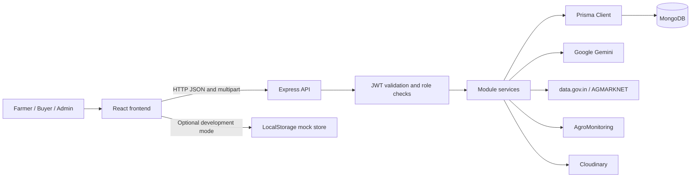

# Krishi Fair — Hackathon Project

Krishi Fair is a React and Express agricultural marketplace for Indian farmers and buyers. It provides crop listings, direct purchases, bidding, buyer KYC, market-price information, agricultural assistance, chat, and administrative workflows.

## 📌 Overview

Farmers can publish crop listings and receive direct purchases or bids. Buyers can browse listings, submit bids after KYC verification, communicate with farmers, and review market information. Administrators can manage users, KYC status, marketplace statistics, and bidding settings.

## 🎯 Problem Statement

The project addresses the gap between farmers and buyers in agricultural selling workflows. Its implementation brings crop listing, bid comparison, market-price lookup, buyer verification, and farmer-buyer communication into one marketplace.

## 💡 Solution

Krishi Fair combines a role-based React web application with an Express API and Prisma data access. Farmers create listings with quantity, price, location, and bidding settings. Buyers browse listings, complete KYC, place bids or buy directly, and chat with sellers. The backend validates requests, enforces roles and ownership, stores marketplace data, and connects to configured AI, market-data, agro-monitoring, and media services.

## ✨ Features

### Core Features

- Public marketplace and crop-detail pages
- Farmer crop listing creation, editing, deletion, and personal listing view
- Direct crop purchase for verified buyers
- Bidding with minimum-price and highest-pending-bid checks
- Bid acceptance, rejection, outbid, and expiry states
- Scheduled bidding-expiry processing through a backend cron job

### User Features

- Farmer, buyer, and admin registration/login flows
- JWT-authenticated sessions persisted by the frontend store
- Buyer KYC submission with Aadhaar, PAN, GST, and document fields
- Farmer-buyer chats, messages, unread counts, and read state
- Profile updates and authenticated image/document uploads
- Market prices, search, and trends
- Weather, forecast, soil, and irrigation-advice views
- Multilingual AI chat and crop analysis with Gemini and fallback responses
- LocalStorage-backed mock mode for frontend development

### Admin Features

- User listing and user detail access
- KYC verification status updates
- User activation/status toggling
- Marketplace statistics
- Bidding-duration settings
- Admin settings and seeded marketplace data

### Technical Features

- Express route/controller/service modules grouped by domain
- Prisma Client with a MongoDB datasource in the active schema
- Request validation and centralized error handling
- CORS configuration for local frontend development
- Optional market-price caching in the database
- Cloudinary upload integration
- Backend Dockerfile using Node 22 Alpine

## 🏆 Hackathon Project

Krishi Fair was developed as a Hackathon Project. The verified project idea is to give farmers and buyers a shared agricultural marketplace with transparent listing and bidding workflows, KYC-aware buyer access, market information, agricultural assistance, and direct communication.

No hackathon name, organizer, date, team information, award, or ranking is specified in the repository.

## 🛠️ Tech Stack

### Frontend

- React 19 with Create React App and CRACO
- React Router for application routes
- Tailwind CSS and Radix UI components
- Zustand for authentication and UI state
- Axios for API requests
- Recharts for dashboard visualizations
- React Hook Form and Zod resolver for forms and validation

### Backend

- Node.js and Express
- JavaScript CommonJS modules
- JWT authentication with `jsonwebtoken`
- Password hashing with `bcryptjs`
- `multer` for multipart upload handling

### Database

- MongoDB datasource declared in the Prisma schema
- Prisma Client and Prisma CLI

### External Services

- Google Gemini for AI chat and crop analysis
- data.gov.in/AGMARKNET for market-price data
- AgroMonitoring for weather and agricultural monitoring data
- Cloudinary for uploaded media

### Tools & Infrastructure

- npm scripts
- Backend Dockerfile
- CRA/CRACO test command
- No checked-in CI/CD workflow

## 🏗️ Architecture



The frontend selects public, authenticated, or role-protected pages through React Router. API modules handle authentication, users, crops, bidding, chat, AI, market data, agro-monitoring, and uploads. Services use Prisma or configured external integrations and return results to the frontend.

## 🔄 How It Works

1. A visitor opens the public landing page, marketplace, crop details, market prices, agro-monitoring page, or AI assistant.
2. A farmer or buyer registers or logs in. The API returns a JWT, and the frontend persists the authenticated user in its Zustand auth store.
3. A farmer creates a crop listing. The backend validates the request and associates the listing with the authenticated farmer.
4. A buyer browses listings and submits KYC information. Bidding and direct-purchase operations check the buyer role and verified KYC status.
5. Buyers place bids or purchase crops. The backend checks bid rules, updates crop and bid states, and creates purchase records when applicable.
6. Users can create chats and send messages. Chat membership is checked before messages are read or written.
7. Market, weather, AI, and upload requests are routed to configured services, with fallback behavior implemented in the market, agro, and AI modules.
8. The frontend renders returned data in dashboards, marketplace pages, chat screens, and assistant views.

## 📁 Project Structure

```text
.
├── backend/
│   ├── prisma/
│   │   ├── schema.prisma
│   │   ├── seed.js
│   │   └── migrations/
│   ├── src/
│   │   ├── config/
│   │   ├── middleware/
│   │   ├── modules/
│   │   │   ├── agro/ ai/ auth/ bidding/
│   │   │   ├── chat/ crop/ market/ upload/ user/
│   │   └── utils/
│   ├── Dockerfile
│   └── package.json
├── frontend/
│   ├── public/
│   ├── src/
│   │   ├── components/
│   │   ├── hooks/
│   │   ├── lib/api/
│   │   ├── pages/
│   │   ├── store/
│   │   ├── App.js
│   │   └── index.js
│   ├── craco.config.js
│   ├── tailwind.config.js
│   └── package.json
├── .gitignore
└── README.md
```

| Directory/File | Purpose |
| --- | --- |
| `backend/src/modules` | API routes, controllers, and services grouped by domain |
| `backend/src/middleware` | Authentication, validation, and error handling |
| `backend/prisma/schema.prisma` | Prisma data models and MongoDB datasource |
| `backend/prisma/seed.js` | Development seed data |
| `frontend/src/pages` | Application screens and route targets |
| `frontend/src/components` | Reusable layout, UI, crop, AI, and workflow components |
| `frontend/src/lib/api` | API client and mock data access |
| `frontend/src/store` | Zustand authentication and UI state |
| `backend/Dockerfile` | Backend container configuration |

## ⚙️ Prerequisites

- Node.js 18 or later; the backend Dockerfile uses Node 22 Alpine.
- npm.
- A MongoDB connection string for the active Prisma schema.
- Credentials for optional Gemini, data.gov.in/AGMARKNET, AgroMonitoring, and Cloudinary integrations.
- A modern browser for the React frontend.

## 🚀 Installation & Setup

### 1. Clone the repository

```bash
git clone https://github.com/rahull2509/krishi-fair.git
cd krishi-fair
```

### 2. Install dependencies

```bash
cd backend
npm install

cd ../frontend
npm install
```

### 3. Configure environment files

Create `backend/.env` and `frontend/.env` using the variables below. Environment files are ignored by the repository and must not be committed.

### 4. Generate Prisma Client and seed development data

From `backend/`:

```bash
npx prisma generate
npx prisma db push
node prisma/seed.js
```

The seed script creates development users, sample crops, and admin settings. It deletes existing crops, admin settings, and users before seeding, so use it only against a development database.

### 5. Start the development servers

In one terminal:

```bash
cd backend
npm run dev
```

In another terminal:

```bash
cd frontend
npm start
```

The configured local defaults are frontend `http://localhost:3000` and API `http://localhost:5000`.

## 🔐 Environment Variables

### Backend: `backend/.env`

| Variable | Required | Description |
| --- | --- | --- |
| `DATABASE_URL` | Yes | MongoDB connection string used by Prisma |
| `PORT` | No | API port; defaults to `5000` |
| `NODE_ENV` | No | Runtime environment; defaults to `development` |
| `JWT_SECRET` | Yes for production | JWT signing secret; the code has an insecure development fallback |
| `JWT_EXPIRES_IN` | No | JWT lifetime; defaults to `7d` |
| `GEMINI_API_KEY` | No | Enables Gemini-backed AI features |
| `GEMINI_MODEL` | No | Gemini model; defaults to `gemini-2.0-flash` |
| `GOV_API_KEY` | No | data.gov.in API credential |
| `GOV_RESOURCE_ID` | No | data.gov.in resource identifier |
| `GOV_API_BASE_URL` | No | data.gov.in base URL |
| `AGRO_API_KEY` | No | AgroMonitoring API credential |
| `AGRO_API_BASE_URL` | No | AgroMonitoring base URL |
| `CLOUDINARY_CLOUD_NAME` | No | Cloudinary cloud name |
| `CLOUDINARY_API_KEY` | No | Cloudinary API key |
| `CLOUDINARY_API_SECRET` | No | Cloudinary API secret |
| `ADMIN_EMAIL` | No | Configured admin email |
| `ADMIN_PASSWORD` | No | Configured admin password |
| `DEFAULT_BIDDING_DURATION` | No | Default bidding duration in hours; defaults to `24` |
| `MARKET_CACHE_ENABLED` | No | Enables market-price database caching |

### Frontend: `frontend/.env`

| Variable | Required | Description |
| --- | --- | --- |
| `REACT_APP_BACKEND_URL` | Yes for API mode | Backend URL used by the frontend and local proxy |
| `REACT_APP_USE_MOCK` | No | Set to `true` to use the LocalStorage mock store |

## 🗄️ Database

The active Prisma schema declares MongoDB and models these entities: `User`, `Crop`, `Bid`, `Purchase`, `Chat`, `Message`, `Notification`, `AdminSetting`, and `MarketPriceCache`. Users have `ADMIN`, `FARMER`, or `BUYER` roles. Crops belong to farmers, bids belong to crops and buyers, purchases connect buyers to crops, and chats connect two users through messages.

Use `npx prisma db push` to apply the active schema during local setup. The checked-in migration directory contains a SQLite-style SQL migration and SQLite migration lock while the active schema declares MongoDB; therefore, the repository does not provide a consistent MongoDB migration-history workflow. The setup above intentionally uses `db push`.

## 🔌 API Reference

All endpoints below are mounted under `/api`. Protected endpoints use a Bearer JWT unless stated otherwise.

### Health and Authentication

| Method | Endpoint | Access |
| --- | --- | --- |
| `GET` | `/health` | Public |
| `POST` | `/auth/register` | Public |
| `POST` | `/auth/login` | Public |
| `GET` | `/auth/me` | Authenticated |

### Users and KYC

| Method | Endpoint | Access |
| --- | --- | --- |
| `PUT` | `/users/profile` | Authenticated |
| `POST` | `/users/kyc` | Buyer |
| `GET` | `/users` | Admin |
| `GET` | `/users/:id` | Authenticated |
| `PATCH` | `/users/:id/kyc-status` | Admin |
| `PATCH` | `/users/:id/toggle-status` | Admin |

### Crops and Bidding

| Method | Endpoint | Access |
| --- | --- | --- |
| `GET` | `/crops` | Public |
| `GET` | `/crops/:id` | Public |
| `GET` | `/crops/my` | Farmer |
| `POST` | `/crops` | Farmer |
| `PUT` | `/crops/:id` | Owner farmer |
| `DELETE` | `/crops/:id` | Owner farmer |
| `POST` | `/crops/:id/buy` | Verified buyer |
| `POST` | `/crops/:id/bids` | Verified buyer |
| `GET` | `/crops/:id/bids` | Authenticated |
| `GET` | `/bids/my` | Buyer |
| `PATCH` | `/bids/:id/accept` | Owner farmer |
| `PATCH` | `/bids/:id/reject` | Owner farmer |
| `PATCH` | `/admin/bidding-duration` | Admin |
| `GET` | `/admin/settings` | Admin |
| `GET` | `/admin/stats` | Admin |

### Chat, AI, Market, Agro, and Uploads

| Method | Endpoint | Access |
| --- | --- | --- |
| `GET` | `/chats/unread` | Authenticated |
| `POST` | `/chats` | Authenticated |
| `GET` | `/chats` | Authenticated |
| `POST` | `/chats/:id/messages` | Chat member |
| `GET` | `/chats/:id/messages` | Chat member |
| `POST` | `/ai/chat` | Public |
| `POST` | `/ai/analyze-crop` | Public |
| `GET` | `/market/prices` | Public |
| `GET` | `/market/search` | Public |
| `GET` | `/market/trends` | Public |
| `GET` | `/agro/weather` | Public |
| `GET` | `/agro/forecast` | Public |
| `POST` | `/agro/irrigation-advice` | Public |
| `GET` | `/agro/soil` | Public |
| `GET` | `/agro/satellite` | Public |
| `POST` | `/upload` | Authenticated |

The AI endpoints accept multipart image uploads or base64 image fields. The upload endpoint expects a multipart field named `file`. Market and agro controllers define the relevant query/body fields, including commodity/search filters, latitude/longitude, and polygon identifiers.

## 🔑 Authentication

Registration supports `FARMER` and `BUYER`; admin registration is rejected. Login and registration return a JWT. The frontend stores the authenticated user in the Zustand auth store and sends the token to protected API requests. Backend middleware verifies the Bearer token and applies role checks. Farmer ownership is checked for crop and bid actions, chat membership is checked for messages, and verified buyer KYC is required for bidding and direct purchase.

## 🔒 Security

- Passwords are hashed with `bcryptjs` before persistence.
- JWT Bearer tokens protect authenticated API operations.
- Role-based authorization covers farmer, buyer, and admin operations.
- Crop ownership and chat membership are checked by the backend.
- KYC identifiers are validated by the backend before submission.
- Express body limits are configured, and multipart AI uploads have a 10 MB limit with restricted image MIME types.
- CORS is configured for local frontend development ports.
- Environment files are ignored by Git.

Never commit `.env` files, API keys, access tokens, passwords, or private credentials. The fallback JWT secret and seeded default credentials must be replaced before production use.

## 🧪 Testing

No project-authored unit, integration, or end-to-end test files were found. The frontend exposes the CRA test command through CRACO:

```bash
cd frontend
npm test
```

No backend test script is defined in `backend/package.json`.

## 🏭 Build & Production

Build the frontend from `frontend/`:

```bash
npm run build
```

Start the backend from `backend/`:

```bash
npm start
```

The backend Dockerfile uses Node 22 Alpine, installs OpenSSL, generates Prisma Client, exposes port `5000`, and runs `npm start`. There is no frontend Dockerfile in the repository.

## 🚢 Deployment

The repository includes only the backend Dockerfile. No Docker Compose file, Kubernetes configuration, cloud-hosting configuration, reverse-proxy configuration, GitHub Actions workflow, or live deployment URL is included.

## 🤝 Contributing

1. Fork the repository.
2. Create a feature branch.
3. Make the change while keeping existing conventions consistent.
4. Run the available frontend build or test checks.
5. Commit and push the branch.
6. Open a Pull Request with a concise description of the change.

## 📄 License

No project license file is currently included in the repository.